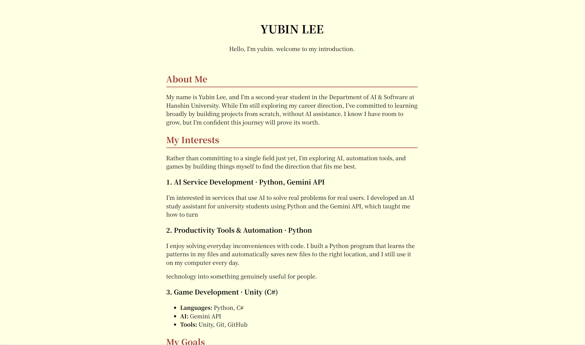

# About Me

개발자로 성장해 가는 과정을 소개하는 자기소개 페이지입니다. 저를 처음 만나는 사람이 제가 어떤 사람이고, 무엇에 관심이 있으며, 어떻게 연락할 수 있는지 한 페이지에서 알 수 있도록 만들었습니다.

🔗 **배포 링크**: https://yubin0114.github.io/about-me/

## 사용 기술

- HTML
- CSS
- Git / GitHub
- GitHub Pages (배포)

## 주요 내용

- **About Me / My Interests / My Goals / Contact** 네 개의 섹션으로 구성
- 시맨틱 태그(`header`, `main`, `section`, `footer`)로 문서 구조를 표현
- 링크 색을 웹 접근성 기준(대비율 4.5:1 이상)에 맞추고, 키보드 사용자를 위한 `:focus-visible` 스타일 적용
- 본문 폭을 `max-width`로 제한해 긴 글도 읽기 편하게 구성

## 배운 점

- **태그 구조는 상자 안의 상자다.** 처음에는 `</head>`를 빠뜨리거나 `main`이 `header` 안에 들어가는 등 태그를 여닫는 위치가 엉켰습니다. 구조를 상자 그림으로 그려 보면서 "나중에 연 태그를 먼저 닫는다"는 원칙을 체감했습니다.
- **HTML은 구조, CSS는 모양.** 제목 태그의 숫자는 글자 크기가 아니라 목차의 깊이라는 것, 줄바꿈과 간격은 ` `이 아니라 CSS로 만든다는 것을 알게 됐습니다.
- **나에게 보인다고 모두에게 보이는 것은 아니다.** 대비를 높이려고 링크 색을 더 밝게 바꿨다가 오히려 안 보이게 됐습니다. 밝은 배경에는 어두운 글자가 필요하다는 것, 그리고 색은 감이 아니라 대비율로 확인해야 한다는 것을 배웠습니다.
- **안 바뀌면 코드보다 먼저 저장·새로고침·캐시를 의심한다.** `a:hover`가 동작하지 않아 한참 찾았는데, 원인은 새로고침을 하지 않은 것이었습니다.
